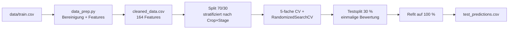

<div align="center">

# 🌾 Hyperspektrale Klassifikation von Kulturpflanzen

**Domänenprojekt 2 · Kulturpflanze und Wachstumsstadium aus EO-1-Hyperion-Satellitenspektren erkennen**

[](https://www.python.org/)
[](https://jupyter.org/)
[](https://scikit-learn.org/)
[](https://pandas.pydata.org/)
[](https://numpy.org/)
[](https://matplotlib.org/)
[](https://seaborn.pydata.org/)
[](https://plotly.com/python/)
[](https://shap.readthedocs.io/)

[](#-ergebnis-auf-einen-blick)

</div>

---

## 📋 Überblick

Aus Hyperspektralaufnahmen des NASA-Satelliten **EO-1 Hyperion** (Reflexion von 400 bis 2400 nm, 30 m Auflösung) sagen wir für jede Messung zwei Dinge vorher:

- die **Kulturpflanze** (`Crop`): corn, cotton, rice, soybean, winter_wheat
- ihr **Wachstumsstadium** (`Stage`): Emerge_VEarly, Early_Mid, Critical, Late, Mature_Senesc, Harvest

Die Daten umfassen 5591 gelabelte Spektren mit 198 Bändern sowie Aufnahmemonat (`Month`) und agroökologische Zone (`AEZ`). Die Klassen sind stark unausgeglichen: `rice` macht nur 1,7 % aus, die Kombination `cotton|Harvest` kommt 11-mal vor. Bewertet wird deshalb mit **Balanced Accuracy**.

## 🏆 Ergebnis auf einen Blick

| | |
|---|---|
| **Abgabemodell** | MLP (Schichten 512 → 256) mit **gemeinsamem Label** `Crop\|Stage` (23 Klassen) |
| **Features** | 164: 131 Spektralbänder, 23 spektrale Kennzahlen, Monat, AEZ (One-Hot) |
| **Testsplit (30 %, nie für Auswahl oder Tuning benutzt)** | Balanced Accuracy **Crop 0.924**, **Stage 0.907** · Macro-F1 0.917 / 0.908 |
| **Erwartung auf dem Validierungsdatensatz** | ≈ 0.92 (Crop) / ≈ 0.91 (Stage) |
| **Abgabedatei** | [`test_predictions.csv`](test_predictions.csv) |

Der Stand zur Abgabe am 31.10.2026 ist als Tag [`abgabe-2026-10-31`](https://github.com/PavithV/LandwirtschaftsProjekt/tree/abgabe-2026-10-31) gesichert.

## 🧰 Tech-Stack

| Werkzeug | Wofür |
|---|---|
|   | Sprache und Notebooks |
|   | Datenaufbereitung und Feature Engineering |
|  | Modelle (RandomForest, HistGradientBoosting, MLP, SVM), Cross-Validation, Hyperparameter-Suche |
|    | Visualisierung (EDA, Konfusionsmatrizen, interaktiver Spektralplot) |
|  | Erklärbarkeit (Feature Importance) |

## 📁 Projektstruktur

```
.
├── final_predictions.ipynb   ← finales Notebook: EDA, Baseline, M2, M3, Abgabe-Vorhersage
├── test_predictions.csv      ← Abgabe: test.csv mit vorhergesagten Spalten Crop und Stage
├── requirements.txt
├── data/
│   ├── train.csv             gelabelte Trainingsdaten (5591 Zeilen)
│   ├── test.csv              Validierungsdatensatz ohne Labels (1397 Zeilen)
│   └── processed/            wird von der Pipeline erzeugt (nicht im Repo)
├── pipeline/
│   ├── _run_pipeline.py      startet Datenaufbereitung und EDA-Plots
│   └── src/
│       ├── data_prep.py      Bereinigung, Interpolation, Feature Engineering, Kodierung
│       └── eda.py            EDA-Grafiken nach output/eda_plots/
├── docs/
│   ├── Aufgabenstellung.docx
│   └── MILESTONE1–3_REPORT.md
└── archive/                  ältere Notebooks der Meilensteine (siehe unten)
```

## 🚀 Schnellstart

```bash
# 1. Abhängigkeiten installieren (scikit-learn >= 1.9 ist Pflicht)
pip install -r requirements.txt

# 2. Daten aufbereiten: erzeugt data/processed/cleaned_data.csv und EDA-Plots in output/
python pipeline/_run_pipeline.py

# 3a. Notebook interaktiv öffnen …
jupyter notebook final_predictions.ipynb

# 3b. … oder komplett ohne Oberfläche ausführen (ca. 40 Min. auf 4 CPU-Kernen)
PLOTLY_RENDERER=plotly_mimetype jupyter nbconvert --to notebook --execute --inplace \
    --ExecutePreprocessor.timeout=-1 final_predictions.ipynb
```

> [!IMPORTANT]
> **scikit-learn ≥ 1.9 wird benötigt.** In Version 1.8 stürzt das MLP mit `early_stopping=True` bei Text-Labels ab („All the 5 fits failed“). Die erste Zelle des Notebooks prüft die Version.

> [!TIP]
> `PLOTLY_RENDERER=plotly_mimetype` verhindert, dass `nbconvert` die komplette plotly.js-Bibliothek (mehrere MB) ins Notebook schreibt.

Das Notebook schreibt am Ende `test_predictions.csv` neu. Getestet wurde mit Python 3.13 und den Versionen aus den Badges oben.

## 🔬 Vorgehen



### 1. Datenaufbereitung (`pipeline/src/data_prep.py`)
1. **Leere Bänder entfernen:** 67 der 198 Bänder sind in allen Zeilen leer (Wasserdampf-Absorption um 1400 und 1900 nm, Sensor-Überlappung, Ränder). Es bleiben 131.
2. **Lücken interpolieren:** linear entlang der Wellenlänge, **pro Spektrum** (zeilenweise, also ohne Datenleck).
3. **Feature Engineering:** 23 spektrale Kennzahlen, ebenfalls zeilenweise.
4. **Kodierung:** `Month` als Zahl plus sin/cos, `AEZ` als One-Hot (7 Spalten). Die Zonen-Nummern sind Kennungen, keine Messwerte.

Im Modell selbst folgen `SimpleImputer` und `StandardScaler`, beide innerhalb einer sklearn-Pipeline und damit pro Fold nur auf Trainingsdaten gelernt.

### 2. Feature-Set (164)

| Gruppe | Anzahl | Inhalt |
|---|---|---|
| Spektralbänder | 131 | Reflexion pro Wellenlänge |
| Statistiken | 8 | Mittelwert, Summe, Streuung, Min, Max, Amplitude, Wellenlänge von Max und Min |
| Vegetationsindizes | 12 | NDVI, SR, EVI · **Red Edge:** NDRE, CI_rededge, REP · Seneszenz: PSRI · Photosynthese: PRI · Wasser und Trockenmasse: NDWI, NDMI, NBR, ND_NIR2_SWIR1 |
| Gradienten | 3 | steilster Anstieg und Abfall pro nm, Gesamtvariation |
| Monat | 3 | `Month`, `Month_sin`, `Month_cos` |
| AEZ | 7 | One-Hot je agroökologischer Zone |

### 3. Validierung und Tuning
- **Split 70/30**, stratifiziert nach `Crop|Stage`, damit alle 23 Kombinationen in beiden Teilen vorkommen. Der 30-%-Teil bleibt bis zum Schluss unberührt.
- **5-fache Cross-Validation** auf den 70 % für Modellvergleich und Tuning.
- **`RandomizedSearchCV`**: 30 Konfigurationen × 5 Folds je Modell und Zielgröße, mit gleichem Budget für HistGradientBoosting und MLP. Beim gemeinsamen Label zählt das Mittel aus Crop- und Stage-Balanced-Accuracy.
- **Testsplit:** einmalige Bewertung der getunten Kandidaten.
- **Abgabe:** feste Hyperparameter, Refit auf **100 %** der gelabelten Daten.

### 4. Abgabemodell

| Hyperparameter | Suchraum | Gewählt |
|---|---|---|
| `hidden_layer_sizes` | (128), (256), (512), (128, 64), (256, 128), (512, 256), (256, 128, 64) | **(512, 256)** |
| `alpha` (L2-Regularisierung) | 0.0001–1 (log-uniform) | **0.045** |
| `learning_rate_init` | 0.0001–0.01 (log-uniform) | **0.0011** |
| `batch_size` | 64, 200 | **200** |
| `early_stopping` / `max_iter` | fest | **True** / 1000 (gestoppt nach 29 Epochen) |
| Optimierer, Aktivierung | sklearn-Standard | Adam, ReLU |

## 📊 Ergebnisse

### Modellvergleich (Balanced Accuracy, gleiches Feature-Set)

| Modell | CV Crop | CV Stage | Test Crop | Test Stage |
|---|---|---|---|---|
| RandomForest (Standard) | 0.872 | 0.853 | – | – |
| HistGradientBoosting (getunt) | 0.903 | 0.875 | 0.888 | 0.874 |
| MLP, separat (getunt) | 0.925 | 0.896 | 0.908 | 0.892 |
| **MLP, gemeinsames Label (Abgabe)** | **0.923** | **0.895** | **0.924** | **0.907** |

### Strategien: separat, gemeinsam, hierarchisch

| Strategie | Idee | Ergebnis |
|---|---|---|
| Separat | 2 Modelle (Crop, Stage) | erzeugt unmögliche Paare wie `winter_wheat\|Early_Mid` (12 von 1678 auf dem Testsplit) |
| **Gemeinsam** | 1 Modell mit 23 Klassen `Crop\|Stage` | gleich gut oder besser, **nur gültige Kombinationen** → Abgabe |
| Hierarchisch | erst Crop, dann ein Stage-Modell je Crop | mit SVM getestet: kein Vorteil gegenüber dem gemeinsamen Label |

Ebenfalls getestet: eine **SVM mit RBF-Kernel** ([`archive/milestone2_model_new.ipynb`](archive/milestone2_model_new.ipynb)), auf dem Testsplit separat 0.922 / 0.899, gemeinsam 0.915 / 0.908, hierarchisch 0.922 / 0.903. Sie liegt damit gleichauf mit dem MLP. Das gemeinsame HistGradientBoosting war instabil (je nach Fold 0.22 bis 0.89).

**Baseline (M1):** RandomForest nur auf Rohbändern mit 0.778 / 0.769 unter scikit-learn 1.8 bzw. 0.824 / 0.806 unter scikit-learn 1.9, wo der RandomForest `class_weight='balanced'` anders behandelt.

### Datenreduktion und Feature Importance (M3)

| Eingabe | Features | Crop | Stage |
|---|---|---|---|
| alle Features | 164 | 0.908 | 0.892 |
| PCA (10 Komponenten) + Monat + AEZ | 18 | 0.914 | 0.902 |
| jedes 4. Band + Monat + AEZ | 41 | 0.911 | 0.892 |
| ohne AEZ | 157 | 0.884 | 0.866 |
| ohne Monat | 161 | 0.911 | 0.845 |
| 10 Sentinel-2-Bänder + Monat + AEZ | 18 | 0.859 | 0.865 |
| nur 10 Sentinel-2-Bänder | 10 | 0.765 | 0.680 |

*Separates MLP, Testsplit. Spektral lässt sich der Input stark reduzieren, Monat und AEZ sind dagegen kaum verzichtbar.*

**Wichtigste Feature-Gruppen** (Rückgang der Balanced Accuracy bei Gruppen-Permutation):
- **Crop:** AEZ (−0.50), SWIR 1800–2400 nm (−0.38), SWIR 1100–1800 nm (−0.30)
- **Stage:** Monat (−0.35), SWIR 1100–1800 nm (−0.31), AEZ (−0.19)

## 📤 Abgabeformat

`test_predictions.csv` ist `data/test.csv` mit allen Originalspalten und -werten, ergänzt um `Crop` und `Stage` an denselben Positionen wie in `train.csv` (direkt nach `Month`). Sie umfasst 1397 Zeilen, nur gültige Kombinationen und die `id`-Reihenfolge wie in `test.csv`.

## ♻️ Reproduzierbarkeit

- Alle Zufallsquellen sind fixiert (`random_state=42`: Split, Folds, Hyperparameter-Suche, Modelle). Ein erneuter Lauf liefert identische Zahlen.
- Die Werte hängen von der scikit-learn-Version ab, vor allem beim RandomForest. Die Notebook-Ausgaben stammen von scikit-learn 1.9.1.
- Das MLP-Ergebnis schwankt je nach Seed um etwa ±0.01. Die Hyperparameter wurden einmal per Cross-Validation gewählt und nicht nach dem Seed ausgesucht.

## 📚 Weitere Unterlagen

| | |
|---|---|
| [`docs/Aufgabenstellung.docx`](docs/Aufgabenstellung.docx) | Projektbeschreibung |
| [`docs/MILESTONE1_REPORT.md`](docs/MILESTONE1_REPORT.md) | M1: Problemverständnis, EDA, Baseline |
| [`docs/MILESTONE2_REPORT.md`](docs/MILESTONE2_REPORT.md) | M2: Modellvergleich, Tuning, Fehleranalyse |
| [`docs/MILESTONE3_REPORT.md`](docs/MILESTONE3_REPORT.md) | M3: Datenreduktion und Feature Importance (SVM-Stand) |

**Archiv** ([`archive/`](archive/)), die Ausgaben stammen aus den jeweiligen Läufen der Meilensteine:

| Notebook | Inhalt |
|---|---|
| `eda.ipynb` | M1: explorative Datenanalyse |
| `baseline_model.ipynb` | M1: RandomForest-Baseline |
| `features.ipynb` | Experimente zum Feature Engineering |
| `milestone2_model.ipynb` | M2: RandomForest vs. HistGradientBoosting vs. MLP (Basis des finalen Notebooks) |
| `milestone2_model_new.ipynb` | M2: SVM separat, gemeinsam und hierarchisch |
| `milestone3.ipynb` | M3: Datenreduktion mit der SVM |
